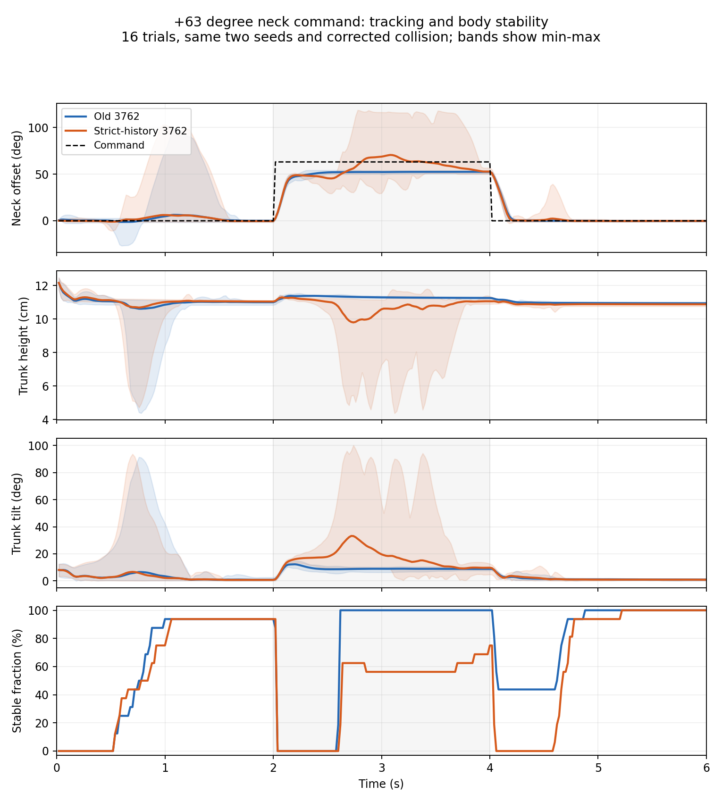
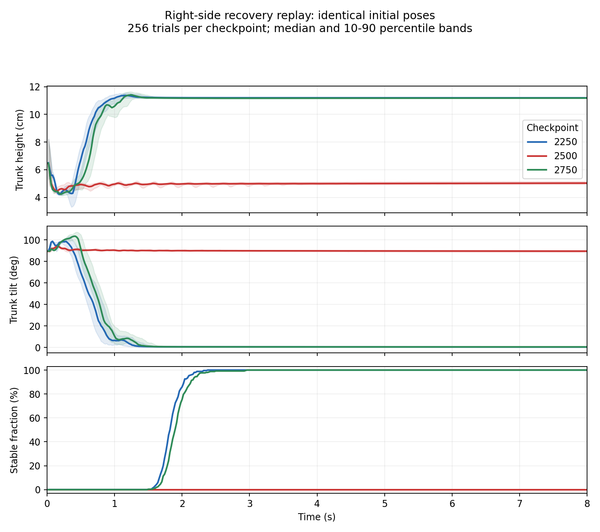

# 3762仅修正碰撞的历史重训：结果与限制

已从随机初始化，使用**单GPU cuda:1、8192环境**，按原10个进程分段完整训练至3762。阶段源码、有效配置、奖励、课程、噪声、PPO、依赖版本和切换逻辑均按历史逐项核验；唯一机器人模型变更为后背/左右外壳新增32个零密度碰撞凸块。总质量仍为0.600941825 kg，既有刚体、惯量、关节、执行器及既有geom参数不变。

**训练链路完成，但新模型尚不能认定为旧3762的全面替代品。** 新碰撞下起身结果更好；+63°颈部角度误差已接近旧模型，但该极限指令下明显失稳，仍需后续单独处理。此次没有因此更改奖励、增加训练或回退原链路，也没有实机验收。

## 交付身份与完整性

- 新ONNX SHA256：`01b5fafde4bde1c33bf5ce1a671b275bd06556354dcacdc9288ba13d47a084e9`
- 新checkpoint_003762.pt SHA256：`caa5d00fd92a430a69c098a10798646e8e6e77405848b6b61d5eb1fbd151c1ea`
- 新resume_003762.pt SHA256：`9073d0549cecfda9c1ec965d5e4c8e76c8acba4f8569908420ba5a201f6f68a4`
- 碰撞XML SHA256：`8ae0d89041950d565bbcd6272ab87317f46132ff1eef99b922782ecbe2b95308`
- 原旧3762基准SHA256：`e753856776bb43e44d9465b4067a0b9cd2d10fe03fc8cb88ee4177ec786f93e1`
- 最终checkpoint/resume的actor、critic、归一化器和优化器一致；ONNX为61D输入、14D输出，66组输入的归一化数值一致性最大误差为7.75e-07。

[完成审阅版协议](STRICT_3762_SINGLE_GPU_REVIEWED_FINAL.md)、[实际冻结协议](STRICT_3762_SINGLE_GPU.md)、[完整训练审计](training-completion-audit.json)。完成审阅版保留原合同哈希，不覆盖当时用于启动的文件。实际执行包括第12次停止、四次独立250更新的头部stage1、阶段性的FMA设置、3506后才启用PairedError，以及原checkpoint/resume保存差别。全部19个评测时点一致。

## 同一修正碰撞下的起身比较

两个模型使用相同的最终历史源码、物理配置、两个原开发种子、每类每种子128样本、8秒、固定恢复阶段5。环境配置已逐字段比对相同（忽略函数对象地址）。这是开发种子上的仿真结果，不是独立留出或实机成功率。

| 初态 | 新历史重训3762 | 旧3762 |
|---|---:|---:|
| standing | 256/256 | 256/256 |
| sitting | 256/256 | 251/256 |
| prone | 256/256 | 256/256 |
| frontier | 256/256 | 253/256 |
| left_side | 256/256 | 256/256 |
| right_side | 256/256 | 1/256 |
| supine | 256/256 | 252/256 |
| 合计 | **1792/1792** | **1525/1792** |

原训练内3762次评测同样为1792/1792。旧模型此次重新实测为1525/1792，未沿用上一轮1535/1792的旧报告；各次仿真不保证逐位一致。

## 头部误差与大角度稳定性

两种子、每指令8次，2秒静止+2秒阶跃+2秒回零。指标为物理关节稳态绝对误差；轴顺序是颈俯仰、头俯仰、yaw、roll。精度训练范围为±0.39/±0.39/±0.49/±0.11 rad。

| 指令组 | 新模型各轴MAE（度） | 旧模型各轴MAE（度） |
|---|---|---|
| 零指令 | 0.390 / 0.301 / 0.281 / 0.332 | 0.293 / 0.281 / 0.364 / 0.368 |
| 小指令 | 0.560 / 0.319 / 0.323 / 0.328 | 0.417 / 0.332 / 0.383 / 0.350 |
| 精度训练范围 | 0.609 / 0.507 / 0.386 / 0.355 | 0.449 / 0.426 / 0.509 / 0.355 |
| 超范围大指令 | 2.167 / 1.336 / 1.539 / 0.568 | 1.838 / 1.314 / 1.835 / 0.486 |

+1.1 rad（+63.03°）颈部单轴案例需要单独看：

| 指标 | 新模型 | 旧模型 |
|---|---:|---:|
| 平均稳态颈部误差 | 11.76° | 10.58° |
| 指令阶段稳定判据满足的时间比例 | 42.2% | 71.1% |
| 指令阶段最低躯干高度 | 4.37 cm | 10.87 cm |
| 指令阶段躯干倾角95分位（合并16次） | 52.64° | 11.92° |
| 出现高度<8cm或倾角>45°的回放 | 7/16 | 0/16 |

最后一行是描述失稳的诊断计数，不是新增训练门槛。新模型在该极限指令下的身体稳定性显著弱于旧模型，不能被接近的平均角度误差掩盖。上一轮非严格6804的归档+63°误差约46.96°；本轮明显改善，但这个跨实验比较不能用于归因某一个单独配置。

全14关节、50Hz控制边界轨迹中，新模型最小物理限位余量为-4.30°（left_hip_roll，+63°颈部案例），旧模型为-4.81°。靠近0.5°限位的最长连续时间分别为0.36s和0.44s。存在短暂限位穿透，不能宣称物理余量验收通过；这些50Hz诊断也不能排除200Hz子步的更大极值。

## 2500次为什么退化，是否需要回退

右侧卧在原生评测中为2250：256/256，2500：0/256，2750：256/256。3000及之后该项也恢复。没有回退训练或新增救援配方。

新进程、相同源码/碰撞/种子/初始姿态的回放复现了这个右侧卧模式，三组初始qpos逐元素相同。2500策略在8秒内始终停留在约5cm高度、约90°倾角的侧卧状态，仍有小幅关节运动，但从未达到站立稳定条件；2250和2750可恢复至约11.2cm高度、不到1°倾角。故这是可复现的中间策略退化，不是普通小样本误差或仅日志显示异常。

只在内存中互换归一化统计、未训练或保存混合策略的诊断结果：

| 网络参数 | 归一化统计 | 右侧卧 |
|---|---|---:|
| 2250 | 2250 | 256/256 |
| 2250 | 2500 | 256/256 |
| 2500 | 2250 | 0/256 |
| 2500 | 2500 | 0/256 |

在这组对照中，失败跟随2500网络参数，而非归一化统计或恢复错误。它定位了退化所在的策略部分，但尚未隔离某一具体奖励项或梯度序列；2750恢复过程中网络与归一化共同更新，本次未单独剥离恢复因素。

原PPO优化混合样本回报，没有每次更新保持每个姿态成功率的单调约束；原polish也是“曾经通过”的单向标志，不会因后续退化清零。见[语义审阅补充](POLISH_STATE_REVIEW_ADDENDUM.md)。此次按原链路继续后已恢复，因此没有回退。2500失败检查点和记录永久保留。

回放并非所有计数逐位一致：2250的分种子坐姿/曾稳定计数有差异，2500的坐姿多通过1个样本；右侧卧256→0→256完整复现。所有差异在comparison-summary.json中列明。

## 证据与范围

- [结构化比较结果](final-evidence/comparison-summary.json)，包含逐轴误差、失稳计数、配置同一性及回放差异。
- [新模型头部逐例报告](final-evidence/head-new.json)、[旧模型头部逐例报告](final-evidence/head-old.json)。
- [新模型全关节诊断](final-evidence/joint-limits-new.json)、[旧模型全关节诊断](final-evidence/joint-limits-old.json)。
- 2250/2500/2750回放与归一化对照位于final-evidence/regression-replay和final-evidence/normalizer-ablation。
- 完整中间检查点、原始轨迹和日志保留于`/home/l40-vm01/data2/experiments/microduck-v2-20261024-strict3762`，不删除失败记录。

最终策略是严格历史链路下的新碰撞实验结果，不是前一轮双GPU6804，也不是诊断用的归一化混合策略。未以额外训练、改奖励或更换最终检查点掩盖问题。
